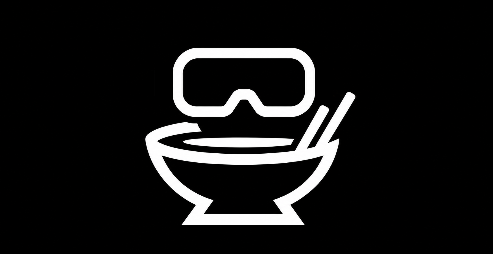
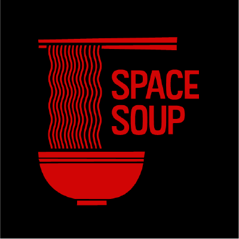

  
  &nbsp;&nbsp;&nbsp;&nbsp;
  

  <h1>SpaceSoup VR</h1>
  
<b>A studio built from the ground up.</b>

  
<a href="https://spacesoup.org">spacesoup.org</a>

---

## Repos

| Repo | Branch | Status |
|---|---|---|
| [space_soup](https://github.com/SpaceSoupVR/space_soup) | `main` | SSNebula clean · desktop/VR renderer and game core |
| [space_soup_engine](https://github.com/SpaceSoupVR/space_soup_engine) | `main` | SSNebula clean · physics, scenes, game runtime |
| [space_soup_protocol](https://github.com/SpaceSoupVR/space_soup_protocol) | `main` | SSNebula clean · wire format |
| [space_soup_app](https://github.com/SpaceSoupVR/space_soup_app) | `main` | SSNebula clean · the Quest 3 player |
| [ssstudio](https://github.com/SpaceSoupVR/ssstudio) | `main` | SSNebula clean · the studio editor |
| [avatar_ik](https://github.com/SpaceSoupVR/avatar_ik) | `main` | SSNebula clean · hands and body IK |
| [avatar_pose](https://github.com/SpaceSoupVR/avatar_pose) | `main` | SSNebula clean · body solver and gait |
| [entity_core](https://github.com/SpaceSoupVR/entity_core) | `main` | SSNebula clean · entities, animation, ragdoll builder |
| [prop_system](https://github.com/SpaceSoupVR/prop_system) | `main` | SSNebula clean · props, holds and playback |
| [hand_menu_core](https://github.com/SpaceSoupVR/hand_menu_core) | `main` | SSNebula clean · the in-VR hand settings menu |
| [bone_animations](https://github.com/SpaceSoupVR/bone_animations) | `main` | SSNebula clean · pose builder and presets |
| [spacesoup_graphics](https://github.com/SpaceSoupVR/spacesoup_graphics) | `main` | SSNebula clean · sky, ground, mud and post |
| [ssr](https://github.com/SpaceSoupVR/ssr) | `main` | SSNebula clean · cross-platform runtime |
| [ssnebula](https://github.com/SpaceSoupVR/ssnebula) | `main` | clean under its own scan · the linter itself |
| [space_soup_server](https://github.com/SpaceSoupVR/space_soup_server) | `main` | cleanup pending · the game server |
| [space_soup_sky](https://github.com/SpaceSoupVR/space_soup_sky) | `main` | cleanup pending · sky and weather |
| [tools](https://github.com/SpaceSoupVR/tools) | `main` | baker and calibration tools |
| [games](https://github.com/SpaceSoupVR/games) | `main` | shipped game data |
| [wgpu](https://github.com/SpaceSoupVR/wgpu) | `spacesoup/v30.0.1` | vendored fork of wgpu 30 |
| [quest_app](https://github.com/SpaceSoupVR/quest_app) | `main` | deprecated — replaced by space_soup_app |
| [space_soup_hands](https://github.com/SpaceSoupVR/space_soup_hands) | — | archived — hand posing lives in avatar_pose + avatar_ik |

*Status as of 2026-10-26. "SSNebula clean" means `ssnebula` reports clear skies on `main`.*
